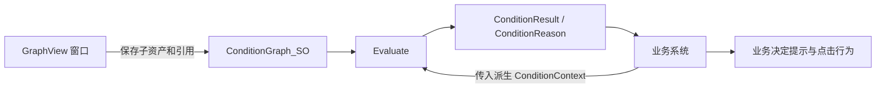
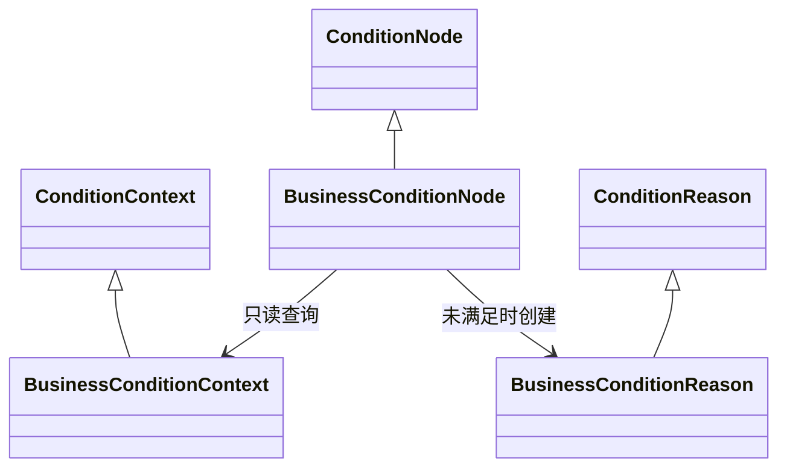

# 通用条件配置模块

## 职责与使用入口

`ConditionGraph_SO` 保存单父节点条件树。业务调用 `graph.Evaluate(context)`，获得 `ConditionResult`；配置不保存当前玩家、上次结果或回调。第一版不替换任务、对话与 GAS 入口。

## 条件与原因

| 节点 | 求值规则 | 未满足原因 |
| --- | --- | --- |
| And | 按列表顺序检查全部子条件 | 收集全部原始原因，Operator 为 And |
| Or | 按列表顺序，首个满足后短路 | 全部失败时保留所有分支，Operator 为 Or |
| Not | 反转唯一子条件的满足状态 | 使用独立配置说明，Operator 为 Not，子原因为空 |
| Constant | 返回配置的固定值 | 返回配置说明 |

原因基类可以继承，业务可追加货币 ID、物品 ID、当前数量、需求数量等字段；组合节点保留这些对象的实际类型。业务自行决定如何展示、点击后打开哪个窗口。条件模块不调用 UIManager。

`ConditionResult.Met()` 表示通过，`ConditionResult.NotMet(reason)` 表示正常未满足；不可变结果使用密封类，满足结果安全复用，派生节点不得返回 null。配置错误和上下文契约错误应抛出异常，不得捕获后转换为 false。

## 业务扩展

1. 继承 `ConditionContext`，在构造时显式传入查询接口、发起者、目标或其他实际需要的数据。不要放入万能字符串字典。
2. 新建名称与脚本文件一致的非抽象 `ConditionNode` 子类，使用序列化字段保存静态参数。
3. 实现 `Evaluate(context)`，明确要求业务自己的上下文类型；只读取数据并返回结果，不扣款、不发送业务事件、不打开窗口。
4. 必要时覆盖 `Validate()`，先调用基类；此方法只校验配置，不访问运行时 Manager。
5. 必要时继承 `ConditionReason`，让业务获得结构化不足项。
6. 普通业务叶子无需覆写子节点容量。编辑器通过 TypeCache 自动发现具体扩展，无需增加类型枚举或 Handler 注册。

图不维护全局 Manager 或业务状态，不执行自动订阅。业务决定何时重新检查；同一份 SO 可以使用不同上下文重复求值。

## 图编辑

菜单：`RPG > Condition > Condition Graph Editor`。使用“新建”创建主 SO，或双击已有条件图打开。画布右键创建节点，第一个节点自动设为根。节点右键可以重新设置无父节点的根。

- 父节点右侧“子条件”连接到子节点左侧“父条件”；叶子没有输出。
- 每个节点至多一个父节点，拒绝自连接、重复连接、循环、跨图连接和容量超限。
- 选中节点后在右侧编辑普通参数。子条件列表的上下按钮改变求值顺序，位置拖动只改变 GraphView 内容坐标。
- “断开”或删除连线保留子节点；删除父节点不销毁其子节点。
- Ctrl+Z / Ctrl+Y 处理撤销与重做。框选后可使用框架右键布局工具。
- “保存”提交主资产与节点子资产；“校验”显示可定位的问题。保存允许保留无效草稿，不进行自动修复。
- 重开窗口恢复最后资产和画布变换，节点位置从各子资产还原。

窗口采用中性石墨灰面板，通过灰阶和细边框区分区域；And 使用低饱和鼠尾草绿、Or 使用棕金、Not 使用灰紫，具体条件使用中性灰标题。组合节点内容区只展示组合表达式，不求值、不展示真假预览，也不调用业务节点 Evaluate。

## 校验约束

缺根、空节点/空子引用、节点 ID 重复、空 And/Or、Not 缺子节点、多个父节点、重复连接、循环、所有权错误和跨图引用都是错误。整图校验在根求值之前执行，包含草稿节点的结构与参数，防止短路掩盖错误。

有效但未连接到根的节点仅警告，不参与求值。若草稿本身存在结构或参数错误，仍阻止图求值。校验不会自动补引用、删除节点或修改参数。

节点和连线使用直接 SO 引用，节点作为主资产的子资产保存。编辑器状态保存在 `Library/ConditionGraphEditorState.asset`，运行时代码不依赖 Editor 命名空间。

## 手动验证

测试脚本：`Test/ConditionSystemOdinTester.cs`，位于 Editor 目录之外且整文件 Editor Guard。可将组件挂到临时 GameObject，通过 Odin 按钮执行；也可使用菜单：

- `RPG > Condition > Run Runtime Verification`：组合真值、Or 短路、子条件顺序、Not 原因、嵌套结构、上下文/原因扩展、重复求值及损坏配置。最后一项故意调用无效图，预期产生一条 `[ConditionGraph]` 错误日志；随后必须看到测试 PASS 和临时对象清理日志。
- `RPG > Condition > Run Asset Round Trip Verification`：在 Test 下创建唯一临时资产，保存后卸载并重新导入，校验参数、稳定 ID、顺序、位置、所有权和子资产引用；finally 删除该测试资产。

GUI 还需验证实际拖线、非法连线拒绝、选择、拖动、布局、断线、删除、属性编辑、顺序按钮、Undo/Redo 和保存重开。编译通过不代表这些交互已验证。
