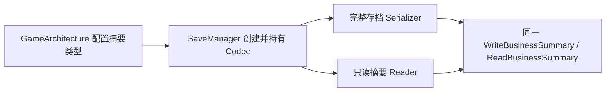
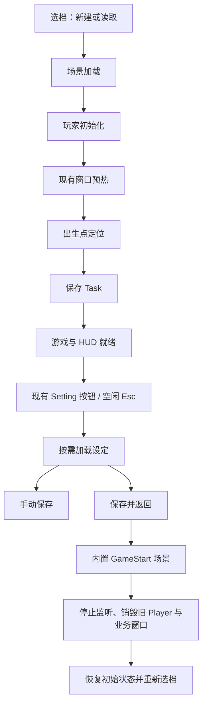

# 游戏存档与会话流程

从 `Assets/Scenes/GameStart.unity` 启动。开始窗口下方固定十个卡位，横向拖动，选中后点击开始。空卡创建新进度，已有卡恢复全部已注册业务模块，统一进入庭院。

## 摘要与职责

`SaveSlotSummary` 保存框架字段并组合 `ISaveBusinessSummary`。RPG 的 `GameSaveSummary` 保存四个队伍槽位的 ID 与名称；头像按当前角色配置加载，头像失败不代表存档损坏。

SaveSystem 检查文件、版本、模块和数据形状，按依赖顺序调用恢复；业务 Manager/System 检查恢复关系并重建索引、监听及事件。装备关系在名册和装备库存恢复之后由 CharacterEquipmentSystem 检查，存档框架不查询业务引用。

## 保存与返回

- 庭院和 Boss 共用任务树，末尾保存 Task 复用手动保存入口；前序失败不保存。自动保存写盘失败允许进入游戏并打开设定提示，取消和内部异常正常传播。
- GameStart 保留在 Build Settings 作为启动场景，返回任务使用 BuiltInSceneLoadTask；游戏场景继续用 Addressables。
- 设定不预热。关闭先隐藏，再销毁窗口并释放图集；游戏时间继续运行，只锁玩家输入。
- 返回先保存，失败留在菜单。成功加载 GameStart 后销毁跨场景 Player，跨帧等待角色资源清理，再重置全部业务状态。
- 全局音量写入 PlayerPrefs，不随游戏存档变化。

## 文件与错误处理

正式文件位于 `Application.persistentDataPath/Saves`。`slot-catalog.json` 保存十个固定卡位与 GUID 的关系，删除只移除该 GUID 的存档文件。不要单独删除或重排目录索引。索引损坏或未分配文件明确报错，不自动删除游戏数据。

只读摘要不保证所有模块都可恢复；完整业务校验在正式读档时执行。部分恢复失败阻止进入游戏并清理会话，不自动丢弃装备或补发物品。

## 手动验证

`Assets/Scripts/Game/Test/GameSaveFlowOdinTester.cs` 位于 Editor 外并使用 Editor Guard；挂到临时测试对象后，在 Inspector 点击摘要对称读写、十档列表和保存按钮。原 SaveSystemOdinTester 继续验证独立存储容器与模块恢复。

重点验证：新建、手动保存、返回后读同档、返回后换另一档、返回后新建、重复切换无 Actor/窗口/事件遗留；四槽头像与名字、删除确认、损坏档、写入失败、全局音量重启保留。

## 本次已执行的验证

- Unity 2022.3.62f2 自动编译通过；摘要往返和构造函数预置四槽集合的反序列化替换检查通过。
- 从 GameStart 的实际开始按钮新建档 1，进入庭院，玩家就绪，末尾 Task 保存成功。
- 在设定中手动保存测试余额 17，退出 Play Mode 后重新读档，余额及三名队伍角色、对应装备实例恢复。
- 保存并返回后旧 Player 销毁、余额重置为 0，WSFrameRoot 实例身份保持一致，加载窗口正常完成。
- 新建档 2 的余额为 0，装备实例与档 1 独立；再次读取档 1 恢复其余额和装备。
- 音乐滑条设为 73%，关闭后 SettingsWindow 已从注册表移除，HUD 恢复；重新加载窗口仍为 73%，随后已恢复测试前的 100%。
- 删除确认、取消保留文件、确认删除均通过。两个本次创建的测试档已清理，保留十个固定卡位索引。
- 未执行独立 Player 构建、磁盘写入失败注入和完整战斗/任务推进回归。
