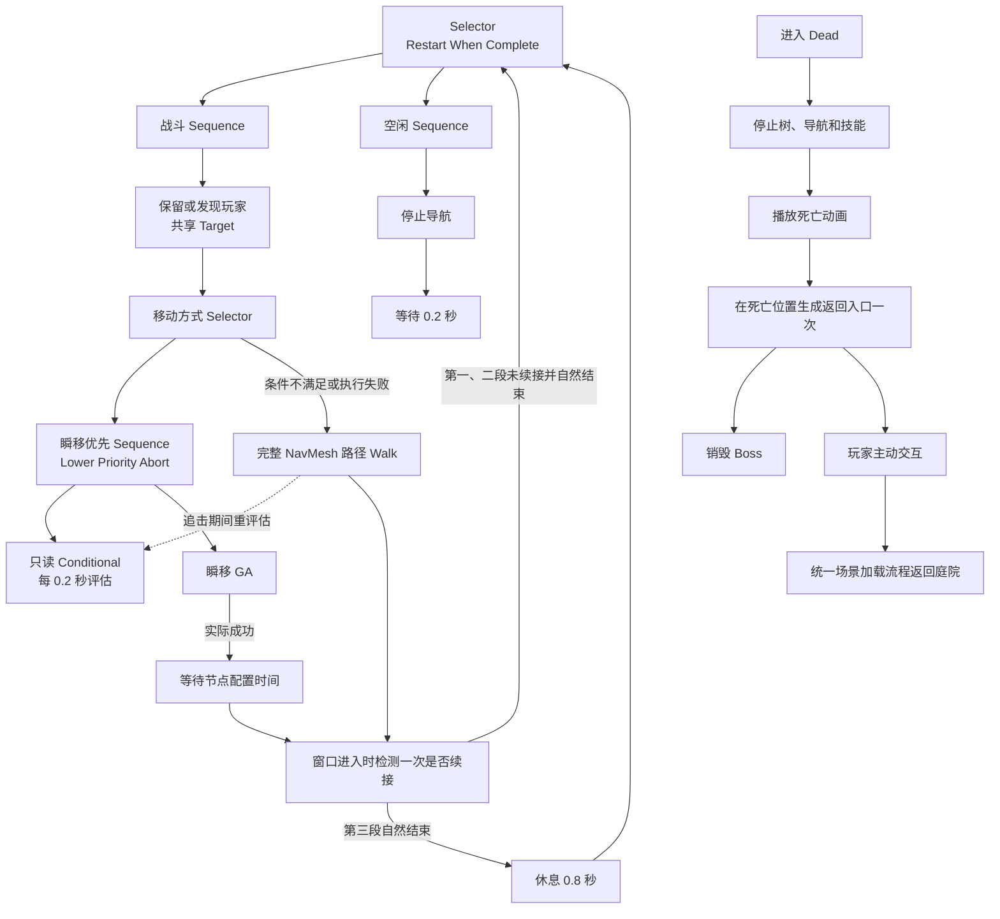
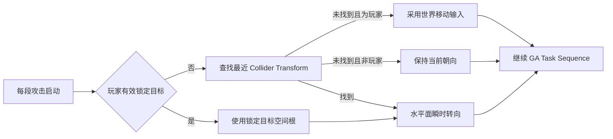

# Boss 行为树、瞬移 GA、窗口续接普攻与击败返回入口

## 目标与边界

复用 `BossScene` 已有的 `NavMeshAgent`、`NavMeshSurface` 和烘焙数据，让 Boss 通过 Walk 绕障追击；仅在完整导航路径过长时尝试独立瞬移 GA。Boss 到达范围后，在第一、二段的 Phase 取消窗口入口检测一次是否续接；第三段自然结束后休息再重新判断。死亡动画自然结束后生成可交互的返回庭院入口，不自动切换场景。

## 行为树与黑板

- 根节点使用 `Selector`，BehaviorTree 组件开启 `Restart When Complete`，关闭 `Reset Values On Restart`，不添加根 Repeater。NPC 属性与技能初始化完成后才启动树；停用或死亡时停止树。
- 树共享 `Target` Transform。有效目标离开首次发现半径后继续保留；目标死亡、停用或失效时清空并重新搜索。
- 首次搜索半径和玩家 Layer 配置在 `FindPlayerByLayer`；攻击距离由树共享 `AttackDistance` 提供，空闲重试由 Idle 分支原生 `Wait` 配置。有效目标离开搜索半径后仍保留。发现目标后使用完整 NavMesh 路径与 `remainingDistance` 判断，不用直线距离作为寻路或远距瞬移依据。
- 追击路径缺失、Pending 或不完整时停止当前路径并按导航间隔重试，不直线移动兜底。角色位移统一由 MotionDriver 和 CharacterController 处理，Controller 将碰撞结算后的根位置同步回 NavMeshAgent。
- Boss 只使用 Idle/Walk 状态；Walk 动画引用 BossMove 及其 X/Y 参数，默认速度 2.5 米/秒。NavMeshAgent 的 Transform 自动位置和旋转更新关闭，避免 Agent 与 CharacterController 双重驱动。

## 瞬移 GA 与攻击等待

- `CanNpcTeleport` 通过只读预检判断完整路径是否严格超过行为树配置阈值，并查询角色占据、移动阻断、Ability Tag 条件、Cooldown GrantedTags、活动 Ability Block 与安全落点。Conditional Abort 设为 Lower Priority；Walk 正在 Running 时也能按节点间隔重新评估并被瞬移 Sequence 抢占。
- Boss 当前瞬移路径阈值保留 5 米，预检间隔 0.2 秒，瞬移 GA 独立冷却默认 3 秒。预检不激活技能或改变导航；激活 Action 会重新检查并保存落点。激活失败按节点重试间隔退避，避免 Lower Priority 反复打断 Walk。
- 理想落点位于玩家世界前方默认 2 米；在 0.5 米半径内采样 NavMesh，并检查落点高度、Boss 胶囊空间和至玩家的环境视线。激活前保存落点，Task 执行时对同一落点再次检查后 Warp。
- 瞬移 Task 记录实际重定位结果。仅 GA 成功完成实际 Warp 后才启动 `WaitAfterNpcTeleport` 的缩放时间等待；当前 Boss 资产保留 0.5 秒。等待期间不寻路、不攻击，也不改变普攻连段缓存。等待完成后重新检查攻击距离与遮挡。

## 三段普通攻击

- `NPCConfig` 按顺序配置独立 Boss Attack1–3；Attack4 保留资产但不加入当前循环。其他授予技能与三段攻击、瞬移 GA 合并去重。
- `NPCCombatSystem` 持有 Spec Handle、下一段序号、默认 3 秒缩放连段缓存、当前 Runtime 与第三段结束休息状态。只有 ASC 激活成功时推进序号和刷新缓存；缓存过期回到 Attack1。攻击距离和第三段休息时间由 `ExecuteNpcNormalAttack` 在节点启动时快照，当前 Boss 休息时长为 0.8 秒。
- `NPCCombatSystem` 订阅 `SkillRuntimeHost.ActionPhaseChanged`，按 `ExecutionId` 和事件中的 RuntimeTags 检测 `Skill.Window.CancelBy.Ability` 从关闭到开启。第一、二段窗口进入时检查目标有效性、范围、遮挡与动作暂停状态，只记录一次结果；共用该标签的相邻 Phase 不重复判定，窗口关闭后再次打开可重新判定。
- 行为树节点消费事件记录的续接机会，并由 ASC 激活事务复核当前 Runtime、取消窗口和激活条件。入口事件在 SkillRuntime 启动调用中同步发布，因此事件回调只记录，交接在回调返回后的行为树更新中执行；每个 Unity 帧最多交接一段。攻击距离由树共享 `AttackDistance` 同时供导航停止、瞬移路径终点和 Phase 窗口判定使用。
- Idle 或行为树重判后启动缓存段位时采用 SkillConfig 时间轴第 0 帧。第一、二段未续接并自然结束后，当前节点完成并让树重判；第三段不交接，只有自然结束后等待默认 0.8 秒才允许下一次普通攻击。
- 保留 Boss GA 中已有的 AttackFacing 前置 Task；扫描按配置 Layer 和半径选最近 Collider，并直接使用 Collider Transform，不依赖目标 ASC。Boss 副本的攻击扫描和攻击检测只对 Player Layer 生效，不改玩家 GA 或共用 SkillConfig。

## 普攻转向与停滞修正

- AttackFacing 的 Collider 扫描分支只用碰撞体 Transform 取位置与距离，不再向父级查询 ASC；排除自身层级，对复合碰撞体按 Transform 去重，等距时按 InstanceId 稳定选择。玩家锁定目标优先级和无扫描目标时的移动输入回退保持原样。
- Boss Attack1–3 的 `cueTags` 配置为空；玩家 GA、Boss Attack4 和共享 Cue 数据不随此项改变。三份 Boss GA 原有扫描半径、Player Layer 与其他用户配置均保留。
- 攻击节点启动时不再接管已取消的旧 Runtime；CombatSystem 首次观察到当前段被取消时将下一段缓存指回该段，不刷新 Combo 倒计时，也不生成自然结束或 Attack3 休息信号。行为树下一周期重新检查并重试该段。
- 导航接近点比共享攻击距离向内预留 0.15 米，避免 Agent 停止容差让 Boss 持续处在攻击范围之外。攻击范围本身、完整路径和遮挡校验保持原值。
- Controller 只在攻击准入原因、目标或激活阻断状态变化时记录诊断，并暴露最近原因、水平距离与激活阻断快照供 Boss Odin Tester 查看，便于区分距离、遮挡、路径计算、路径未到达、动作暂停与 FullBody 占据。

## 死亡返回入口

- 普通 NPC 的死亡完成 Prefab 可不配置；Boss 配置现有 `DefeatBossLeaveEntry.prefab`。
- `NPCDeadState` 的 Animancer 死亡动画结束回调调用 Controller 的一次性完成处理，在死亡位置以世界单位旋转生成独立 Prefab，再销毁 Boss。不会在普通 Destroy、停用或场景卸载时生成。
- 击败事件保持在进入 Dead 时发送，不等待死亡动画，也不重复发送。返回入口不作为 Boss 子物体，玩家交互后通过已有 `SceneTransitionInteractable` 和统一场景加载流程返回 `UnityReadyMarketCourtyard`；不自动传送、不记录动态来源场景。
- 入口显示文案为“返回庭院”，交互碰撞使用 Trigger BoxCollider，并沿用项目现有玩家交互检测 Layer。

## 预计文件

预计修改的现有文件：

- `Assets/Scripts/NPC/Plans/BossBehaviourTree_Plan.md`
- `Assets/Scripts/NPC/NPC_README.md`
- `Assets/Scripts/NPC/Runtime/NPCConfig.cs`
- `Assets/Scripts/NPC/Runtime/NPCController.cs`
- `Assets/Scripts/NPC/Runtime/NPCActor.cs`
- `Assets/Scripts/NPC/Runtime/BossLocomotionStateMachine.cs`
- `Assets/Scripts/NPC/Runtime/States/NPCDeadState.cs`
- `Assets/Scripts/NPC/Test/BossOdinTester.cs`
- `Assets/GAS_Light/AbilitySystem/Runtime/Test/GameplayAbilityOdinTester.cs`
- `Assets/Scripts/Character/Action/Runtime/IFullBodyActionRegistrationOwner.cs`
- `Assets/GAS_Light/AbilitySystem/Runtime/GAData/SkillSystemTask/PlaySkillConfigGameplayAbilityTaskConfig.cs`
- `Assets/Scripts/NPC/Config/Boss_Odetta_Config.asset`
- `Assets/Prefabs/NPC/Boss_Odetta.prefab`
- `Assets/Prefabs/Other/DefeatBossLeaveEntry.prefab`
- `Assets/Scenes/BossScene.unity`
- `Assets/GAS_Light/AbilitySystem/Runtime/GAData/SO/GA_Boss_Odetta_Attack_1.asset`
- `Assets/GAS_Light/AbilitySystem/Runtime/GAData/SO/GA_Boss_Odetta_Attack_2.asset`
- `Assets/GAS_Light/AbilitySystem/Runtime/GAData/SO/GA_Boss_Odetta_Attack_3.asset`
- `Assets/GAS_Light/AbilitySystem/Runtime/Database/GameplayAbilityDatabase.asset`
- `Assets/GAS_Light/TagSystem/TestSO/GameplayTagDatabase.asset`
- `Assets/GAS_Light/TagSystem/Generated/GameplayTags.Generated.cs`

预计新增文件：

- `Assets/Scripts/NPC/Runtime/NPCCombatSystem.cs`
- `Assets/Scripts/NPC/Runtime/BehaviourTree/FindPlayerByLayer.cs`
- `Assets/Scripts/NPC/Runtime/BehaviourTree/NavigateToAttackPosition.cs`
- `Assets/Scripts/NPC/Runtime/BehaviourTree/TryNpcTeleport.cs`
- `Assets/Scripts/NPC/Runtime/BehaviourTree/ExecuteNpcNormalAttack.cs`
- `Assets/Scripts/NPC/Runtime/BehaviourTree/StopNpcNavigation.cs`
- `Assets/Scripts/NPC/Runtime/BehaviourTree/WaitAfterNpcTeleport.cs`
- `Assets/GAS_Light/AbilitySystem/Runtime/GAData/ConcreteSkill/NpcTeleportGATask.cs`
- `Assets/GAS_Light/AbilitySystem/Runtime/GAData/SO/GA_Boss_Odetta_Teleport.asset`
- `Assets/GAS_Light/GameEffectSystem/Runtime/DataConfig/SO/GE_Boss_Odetta_Teleport_Cooldown.asset`
- `Assets/Prefabs/NPC/AI/Boss_Odetta_BT.asset`

预计删除文件：

- `Assets/Scripts/NPC/Runtime/NPCActionArbiter.cs`

瞬移 Ability 的 Cooldown Effect 将在实施前核对现有 GameEffect SO 目录后创建。场景已有 NavMeshAgent 与烘焙数据，除行为树和 Agent 同步参数外不重建导航场景内容。

## 验证

- 1 级、中间等级与最大等级 Boss 的烘焙属性初始化仍有效，行为树只在初始化成功后启动。
- 目标保持、失效、首次发现范围、完整路径绕障、无效路径重试与碰撞移动正确；无 Agent 自动 Transform 更新或双重位移。
- 瞬移冷却、无安全落点、成功 Warp 和执行前落点失效分别验证；只有成功后等待完整 1 秒。
- 三段攻击序号、缓存过期、空闲从第 0 帧启动、Active Phase 实时交接、失败不推进以及 Attack3 根节点完成重启正确。
- 死亡入口只在动画结束时生成一次，Boss 销毁后入口保持；Trigger、文案、目标场景 ID 与统一返回流程有效。
- Unity Gate 集中修改，仅 Refresh 一次；等待 Editor 编译空闲后最多构建一次 `Assembly-CSharp-Editor.csproj`。编译、资产 Bake、NavMesh 与 Play Mode 行为分别报告。
